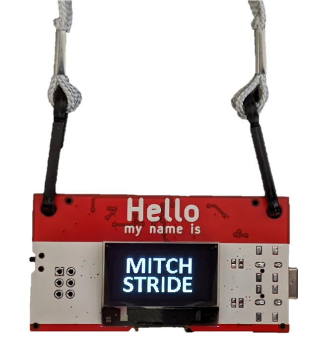
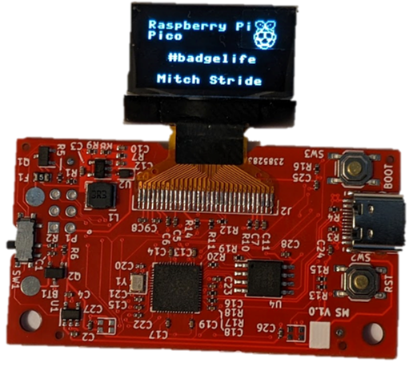
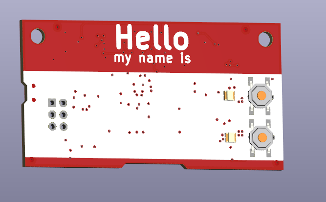
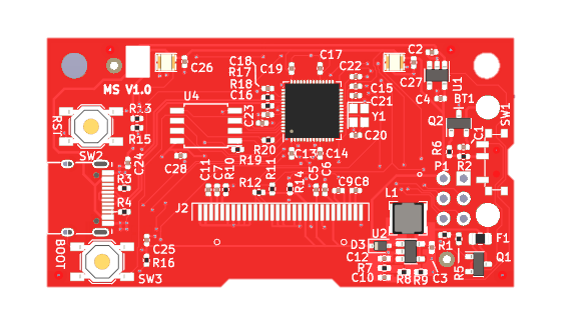

# 🎉 "Hello My Name Is" PCB Badge

 
 
 

This **#Badgelife** PCB was created to test some circuits for future art PCBs.  
It also served as a small project to bring to local hardware meetups. Partial assembly was done at JLCPCB.

  
*Missing front buttons on this test PCB*

---

## 🔧 Features
- Powered by 2× AA Batteries
- Highly compatible with JLCPCB's basic SMT parts
- Raspberry Pi RP2040 microcontroller with dual-core ARM Cortex-M0+
- OLED Screen, RGB LEDs, Buttons
- SAO Connector

---

## ⚠️ v1 Issues
I rushed this project a lot. The schematic was done in a few nights, layout and routing in a few hours with no review. This PCB has a few mistakes. Not planning another spin, but leaving this list here:  

Click to expand v1 Issues

- I saw someone else's design online using an RGB LED running at 3.3V (below spec). I tried to replicate it, and the LEDs were very flaky and worked intermittently. Experiment failed 😢.  
- AA boost converter not yet tested; currently using USB power only.

---

## 📝 v2 Wishlist

Click to expand v2 Todo

- User LED + Power LED  
- ON/OFF silk on switch  
- Buzzer would be fun  
- 5.1k USB CC1/CC2  
- Planes on battery terminals to prevent lifting  
- Use RPi boost for AA supply instead of boost converter  
  - It’s nice to have 5V for LEDs  
- SAO connector is too big for this little PCB  
- GND probe clip stuffing option  
- Level shifter for RGB LEDs  

  

---

## ⚡ Example GIF

